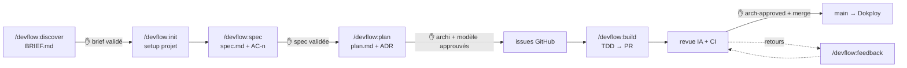

# devflow

Un framework de développement assisté par IA, packagé en **plugin Claude Code**, utilisable dans n'importe quel projet (web, mobile, desktop, API), neuf ou existant.

- **Claude** clarifie, spécifie, planifie, code en TDD, vérifie, commit, pousse et ouvre la PR.
- **Toi** tu valides le brief, les specs, l'architecture et le modèle de données, et tu merges.
- Le déploiement reste géré par Dokploy : devflow s'arrête au merge sur `main`.

## Le principe

La doc officielle de Claude Code distingue deux types d'instructions ([best practices](https://code.claude.com/docs/en/best-practices)) :

- **non déterministes** (prompt, `CLAUDE.md`, skills) : Claude les suit presque toujours, mais c'est lui qui décide ;
- **déterministes** (hooks, règles `deny`, CI, protection de branche) : le harnais les applique à chaque fois.

devflow met la méthode dans des skills (souple, Claude juge selon le contexte) et les règles sans exception dans des hooks et la CI. Exemple : « ne jamais merger une PR » n'est pas une phrase dans `CLAUDE.md`, c'est un hook qui bloque `gh pr merge` et une règle `deny`.

## Le cycle



✋ = point de validation humaine. Claude ne passe jamais à l'étape suivante sans ton accord explicite.

| Étape | Commande | Produit | Ta décision |
| --- | --- | --- | --- |
| Clarifier | `/devflow:discover [idée]` | `docs/product/BRIEF.md`, `questions-client.md`, ADR de stack | Valider le MVP et le hors scope |
| Installer | `/devflow:init` | `CLAUDE.md`, `.claude/`, `docs/`, `.github/`, labels | Accepter les fichiers et réglages GitHub |
| Spécifier | `/devflow:spec <fonctionnalité>` | `docs/specs/NNN-slug/spec.md` | Valider les critères d'acceptation |
| Planifier | `/devflow:plan <NNN>` | `plan.md`, ADR, issues GitHub | **Approuver architecture et modèle de données** |
| Développer | `/devflow:build <issue>` | branche, commits, PR avec preuves | — |
| Relire | `/devflow:review [pr]`, `/devflow:feedback <pr>` | rapport, corrections | **Poser `arch-approved` si besoin, merger** |
| Capitaliser | `/devflow:learn <leçon>`, `/devflow:adr` | règles, décisions | Accepter la règle |
| Piloter | `/devflow:status` | tableau de bord | Choisir la suite |

## Contenu du dépôt

```
.claude-plugin/marketplace.json     # ce dépôt est aussi un marketplace de plugins
plugins/devflow/
  .claude-plugin/plugin.json
  skills/        discover, init, spec, plan, build, review, feedback, adr, learn, status
  agents/        spec-reviewer (revue lecture seule), architect (options d'archi)
  hooks/         guard-bash, guard-files, quality-gate (Stop), session-context
  reference/     conventions.md, testing.md, stack-defaults.md
  templates/
    docs/        brief, spec, plan, adr
    project/     fichiers copiés par /devflow:init (CLAUDE.md, CI, PR template…)
  scripts/       scaffold.mjs, setup-github.mjs
tests/           tests des hooks (node --test)
```

## Installation (une fois)

1. **Publier ce dépôt sur GitHub** sous le nom `devflow` (public de préférence, voir [Limites](#limites-connues)). Les placeholders `{{GITHUB_OWNER}}` des templates sont remplis par `/devflow:init` dans chaque projet.
2. **Installer le plugin** dans Claude Code :
   ```
   /plugin marketplace add <ton-user-github>/devflow
   /plugin install devflow@oumar-plugins
   ```
   Pour tester sans installer : `claude --plugin-dir ./plugins/devflow`, puis `/reload-plugins` après chaque modification.
3. **Prérequis** sur ta machine : Node 20+, `gh` authentifié (`gh auth login`, plus `gh auth refresh -s project` si tu utilises GitHub Projects).

Vérifier le plugin : `claude plugin validate ./plugins/devflow` et `node --test tests/*.test.mjs`.

## Démarrer un nouveau projet

```bash
mkdir mon-projet && cd mon-projet && git init
claude
```
1. Dépose les éléments du client (comptes-rendus, mails, cahier des charges) dans `docs/product/sources/`.
2. `/devflow:discover une app de réservation pour salons de coiffure` — Claude lit les sources, t'interroge par questions à choix multiples, challenge le périmètre, écrit le brief, la liste de questions à envoyer au client et l'ADR de stack. Tu valides.
3. `/devflow:init` — propose la commande officielle de création (create-next-app, create-expo-app…), puis installe devflow.
4. `/devflow:spec prise de rendez-vous` puis `/devflow:plan 001` puis `/devflow:build <issue>`.

## Intégrer un projet existant

```bash
cd projet-existant && claude
```
1. `/devflow:init` — audit du dépôt (stack, scripts, CI existante), puis ajout des fichiers manquants. Rien n'est écrasé : les fichiers déjà présents (CLAUDE.md, settings, CI) sont complétés à la main avec ton accord.
2. Vérifie le contrat de scripts : `typecheck`, `lint`, `test`, `check:fast`, `check`. Si le projet ne passe pas `check` aujourd'hui, lance Claude avec `DEVFLOW_STOP_GATE=0` le temps d'assainir.
3. Enchaîne sur `/devflow:spec` pour la prochaine fonctionnalité, ou directement `/devflow:build` sur une issue existante bien écrite.

## Au quotidien

**En local**
- Une issue : `/devflow:build 42`.
- Plusieurs en parallèle, chacune dans son worktree : `claude -w 42-login`, `claude -w 43-export` (le fichier `.worktreeinclude` copie tes `.env` dans chaque worktree).
- Une correction que tu as dû faire deux fois : `/devflow:learn ne jamais utiliser Date.now() dans les tests, utiliser vi.useFakeTimers`.

**Dans GitHub** (après `/install-github-app` et le secret `CLAUDE_CODE_OAUTH_TOKEN` créé avec `claude setup-token`)
- Label `ready-for-claude` sur une issue `task` → Claude lance `/devflow:build` dans GitHub Actions et ouvre la PR.
- `@claude corrige le test qui échoue` ou `@claude applique les retours` dans une PR → Claude répond et pousse.
- Revue automatique de chaque PR par le plugin officiel `code-review` (workflow `claude-review.yml`, optionnel).

**Ta revue d'une PR**
1. Lire le résumé, la section « Impact architecture » et les preuves de vérification.
2. Si le check `guard` est rouge : la PR touche une zone sensible. Relire ces fichiers, puis poser le label `arch-approved`.
3. CI verte → merger. Dokploy déploie.

## Garde-fous déterministes

| Règle | Mécanisme |
| --- | --- |
| Seul l'humain merge et approuve | hook `guard-bash` + `deny: Bash(gh pr merge *)` |
| Seul l'humain pose `arch-approved` | hook `guard-bash` |
| Pas de push sur `main`, pas de force push, pas de `--no-verify` | hook `guard-bash` + protection de branche |
| Pas de `prisma migrate reset` ni `db push --accept-data-loss` | hook `guard-bash` |
| Pas d'accès aux `.env` | hook `guard-files` + `deny: Read(./.env)` |
| Migrations versionnées immuables | hook `guard-files` |
| Le code passe `check:fast` avant que Claude rende la main | hook `Stop` `quality-gate` (relance seulement si le code a changé, rend la main après 3 échecs) |
| Zone sensible modifiée → revue humaine obligatoire | workflow `arch-guard.yml` + `.github/arch-paths.txt` + check requis |
| CI verte avant merge | `ci.yml` + protection de branche |

Tout le reste (TDD, découpage, qualité de la spec, revue) est porté par les skills et l'agent `spec-reviewer` : Claude l'applique avec jugement.

## Personnaliser

- **Zones sensibles** : `.github/arch-paths.txt` dans chaque projet.
- **Quality gate** : le script `check:fast` du projet décide de ce qui tourne ; `DEVFLOW_STOP_GATE=0` le coupe, `DEVFLOW_STOP_GATE_MAX_ATTEMPTS` change le nombre de tentatives.
- **Stack par défaut** : `plugins/devflow/reference/stack-defaults.md`.
- **Conventions** (branches, commits, labels, Definition of Done) : `plugins/devflow/reference/conventions.md`. Le `CLAUDE.md` d'un projet peut surcharger n'importe quel point.
- **Effort** : `plan`, `spec`, `discover` et les agents tournent en effort `high`. Pour une tâche `build` délicate, `/effort high` avant de la lancer.
- Après une modification du plugin : incrémenter `version` dans `plugin.json`, pousser, puis `/plugin` pour mettre à jour.

## Limites connues

- **Dépôt du plugin privé** : l'installation du plugin dans GitHub Actions (`plugin_marketplaces`) clone le dépôt ; avec un dépôt privé, ce clonage risque d'échouer. Le plus simple est de garder `devflow` public (il ne contient aucun secret).
- **`build` déclenché par label** : c'est le mode automatique de `claude-code-action` avec une skill comme prompt. Il est documenté, mais teste-le sur un dépôt jouet avant de t'y fier ; le mode `@claude` est le plus éprouvé.
- **Protection de branche** : indisponible sur les dépôts privés du plan GitHub Free. Sans elle, `arch-guard` et la CI restent des signaux visibles, pas des verrous ; les hooks locaux, eux, s'appliquent toujours.
- **Auteur des PR** : en local, les PR sont créées avec ton compte `gh` ; tu ne peux donc pas les « approuver » sur GitHub, d'où l'absence de revue obligatoire dans la protection de branche. Les PR créées dans GitHub Actions sont signées `claude[bot]`.
- **Coûts** : chaque run GitHub Actions consomme des minutes Actions et des tokens (ou ton abonnement avec le token OAuth). Le workflow de revue automatique tourne à chaque push : désactive-le si c'est trop.
- **Les hooks ne sont pas un bac à sable** : ils filtrent des commandes, pas des intentions (un script qui lit `.env` passerait). Pour un vrai confinement, active le sandbox (`/sandbox`).

## Sources

- [Best practices for Claude Code](https://code.claude.com/docs/en/best-practices)
- [Extend Claude with skills](https://code.claude.com/docs/en/skills.md)
- [Create custom subagents](https://code.claude.com/docs/en/sub-agents.md)
- [Hooks reference](https://code.claude.com/docs/en/hooks.md)
- [Create a Claude Code plugin](https://code.claude.com/docs/en/plugins/create.md)
- [Plugin manifest reference](https://code.claude.com/docs/en/plugins/manifest-reference.md)
- [Marketplace reference](https://code.claude.com/docs/en/plugins/marketplace-reference.md)
- [Claude Code GitHub Actions](https://code.claude.com/docs/en/github-actions.md)
- [Conventional Commits 1.0.0](https://www.conventionalcommits.org/fr/v1.0.0/)
