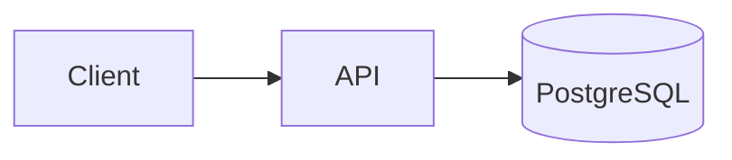

# Plan {{NNN}} — {{Titre}}
Statut : Brouillon ({{date}})
Spec : [spec.md](./spec.md)

## Résumé de l'approche
3 à 5 phrases : ce qu'on construit techniquement et pourquoi cette approche.

## Options étudiées
| Option | Pour | Contre | Retenue |
| --- | --- | --- | --- |
| A | | | ✅ |
| B | | | |

Décisions structurantes → ADR : {{liens}}

## Architecture

- Composants créés / modifiés et leurs responsabilités.

## Modèle de données ⚠️ validation humaine
```prisma
// Diff du schéma : modèles, champs, relations, index, contraintes
```
- Migration : nom, réversibilité, données existantes à migrer (backfill), impact sur la prod.
- Données personnelles stockées et pourquoi.

## Contrats d'API ⚠️ validation humaine si consommés par un client
| Méthode | Route | Entrée (schéma Zod) | Sortie | Erreurs |
| --- | --- | --- | --- | --- |

## Sécurité et autorisations
- Qui a le droit de faire quoi, où c'est vérifié.

## Nouvelles dépendances ⚠️ validation humaine
| Paquet | Pourquoi | Alternative sans dépendance |
| --- | --- | --- |

## Stratégie de test
| AC | Niveau de test | Fichier prévu |
| --- | --- | --- |
| AC-1 | API | |

## Découpage en tâches
Chaque tâche = une issue = une PR (< ~400 lignes). Ordre d'exécution.

| # | Tâche | AC couverts | Dépend de | Zone sensible | Taille |
| --- | --- | --- | --- | --- | --- |
| T1 | | | — | oui / non | S / M |

## Risques et points d'attention
- 

## Hors scope technique
- 
